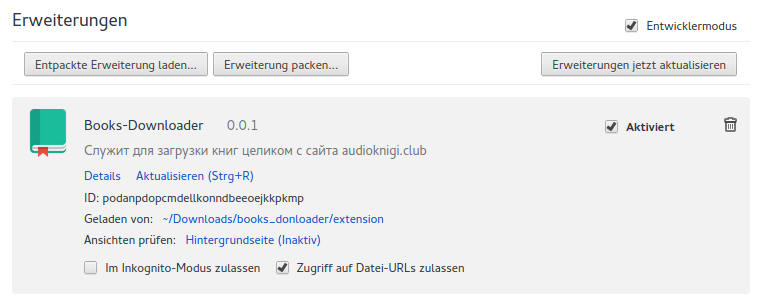
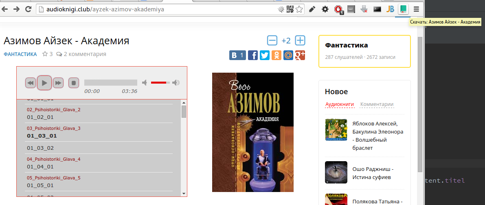
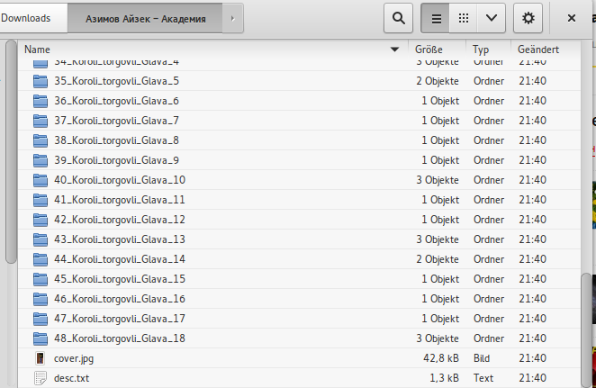

# Books-Downloader

Дополнение которое позволяет скачивать Аудиокниги с сайта
[akniga.org](https://akniga.org/) целиком.

Браузеры:
- Google Chrome
- Microsoft Edge
- Firefox (в том числе Android)

При Закачке создаётся отдельная папка, в которую будут сохранены все аудиофайлы а также описание и обложка.

## Установка (Google Chrome / Microsoft Edge на компьютере)

1. Скачиваем `audioknigi_donloader.zip` из [последнего релиза](https://github.com/phoenixrvd/Books-Downloader/releases/latest) и распаковываем
2. Открываем `chrome://extensions` в Chrome или `edge://extensions` в Edge
3. Активируем "Developer mode" (как на картинке)
4. Нажимаем "Load unpacked" и выбираем распакованную папку, содержащую `manifest.json`



## Установка (Firefox)

1. Открываем [Firefox](https://www.mozilla.org/de/firefox/new/)
2. Устанавливаем [Add-On](https://addons.mozilla.org/de/firefox/addon/books-downloader/)

## Скриншоты
**В браузере**



**После закачки**



## Источники и лицензии

Иконки взяты [здесь](http://www.iconarchive.com/show/small-n-flat-icons-by-paomedia/book-bookmark-icon.html).

Лицензия: [MIT](LICENSE)

## Development

```sh
npm ci
npm run build
npm run watch
npm run dist:zip
```
